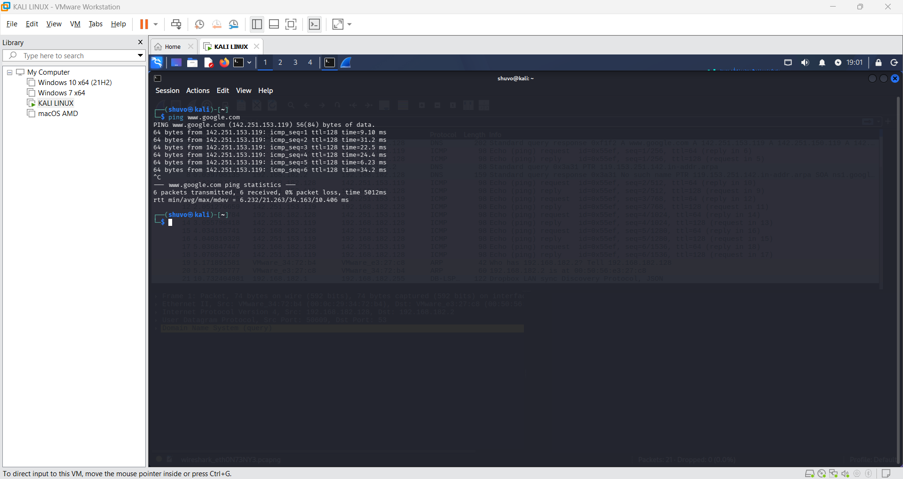
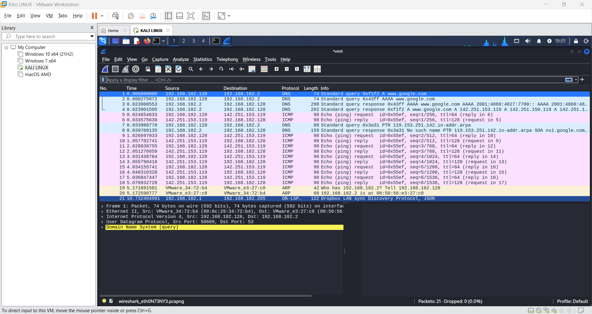

# Task 5: Capture and Analyze Network Traffic Using Wireshark

Cyber Security Internship (Elevate Labs): capture live network packets and identify basic protocols and traffic types.

## What I did

1. Opened Wireshark on a Kali Linux VM (VMware Workstation) and started a capture on the `eth0` interface.
2. Ran `ping www.google.com` in the terminal to generate traffic (6 echo requests, 0% packet loss).
3. Stopped the ping with Ctrl+C, then stopped the capture (21 packets captured, 0 dropped).
4. Filtered the packets by protocol and identified the protocols in the capture.
5. Saved the capture as a `.pcap` file and wrote a report.

## Environment

| Item | Detail |
| --- | --- |
| Tool | Wireshark (free) |
| OS | Kali Linux (VM in VMware Workstation) |
| Interface | eth0 |
| VM IP | 192.168.182.128 |
| DNS server / gateway | 192.168.182.2 |
| Ping target | www.google.com (142.251.153.119) |

## Protocols identified

| Protocol | Packets | What it did |
| --- | --- | --- |
| DNS | 1, 2, 3, 4, 7, 8 | Resolved www.google.com (A and AAAA records) and a reverse (PTR) lookup |
| ICMP | 5, 6, 9 to 18 | Echo requests and replies from the ping |
| ARP | 19, 20 | Found the gateway's MAC address (192.168.182.2 is at 00:50:56:e3:27:c8) |
| DB-LSP-DISC | 21 | Dropbox LAN sync discovery broadcast from another device on the network |

No TCP or HTTP traffic appeared, because ping uses ICMP and DNS used UDP port 53.

## Display filters used

- `dns`
- `icmp`
- `arp`
- `ip.addr == 142.251.153.119`

## Repository contents

| File | Description |
| --- | --- |
| `capture.pcap` | Packet capture exported from Wireshark |
| `Wireshark_Task5_Report.pdf` | Full report with screenshots, protocol analysis and interview answers |
| `screenshot1_ping.png` | Ping output in the Kali terminal |
| `screenshot2_wireshark.png` | Wireshark packet list and Frame 1 details |
| `README.md` | This file |

## Screenshots

## Key learnings

- A single `ping` triggers several protocols: DNS to find the address, ICMP for the echo, and ARP to find the gateway's MAC address.
- Wireshark shows every layer of a packet: Ethernet, IP, UDP/ICMP and the application protocol.
- Capture and display filters keep large captures readable.
